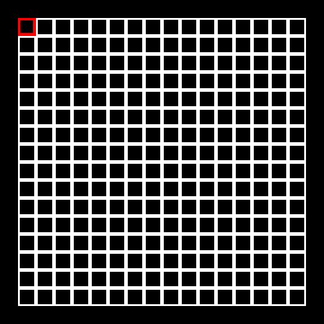
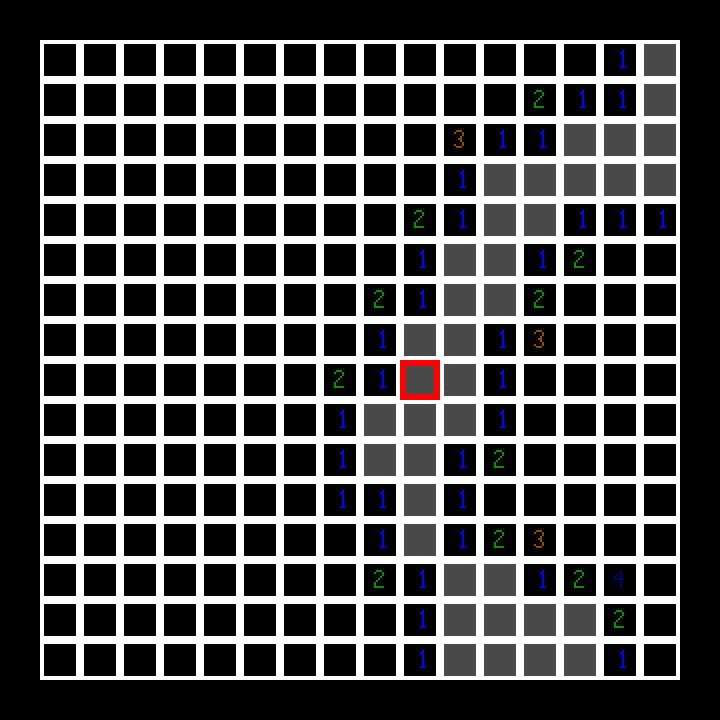
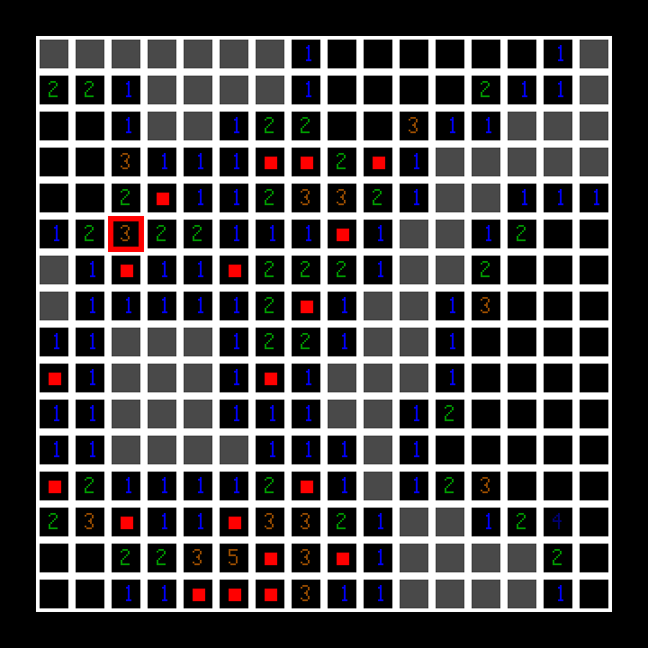
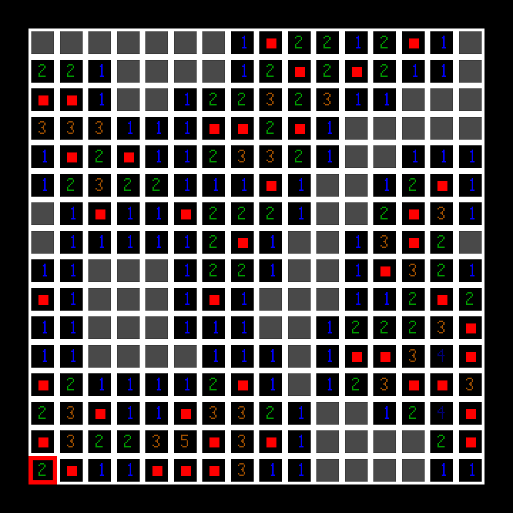
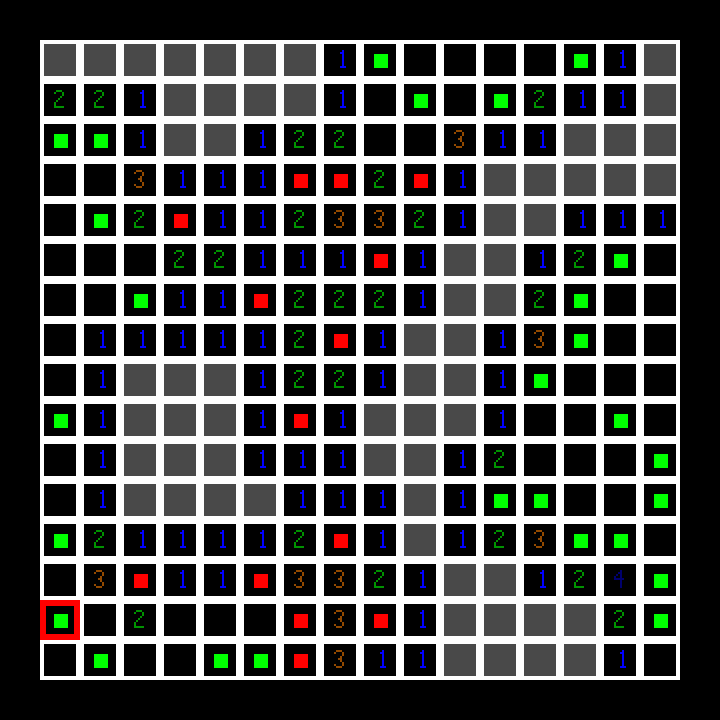
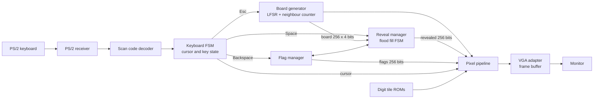

# Minesweeper on an FPGA

A complete game of Minesweeper built from digital logic alone. There is no processor and
no software: the board generator, the flood fill, the keyboard handling and the video
output are all hardware state machines written in Verilog for the DE1-SoC board.

Built for ECE241 (Digital Systems) at the University of Toronto, Fall 2025.

  

<em>A full game, first move to cleared board.</em>

## What it does

- 16 x 16 board on a 640 x 480 VGA display, played with a PS/2 keyboard
- A new random board every game, seeded by the moment the player presses the key
- Revealing an empty tile opens the whole connected empty area
- Flags, game over with every mine shown, and win detection
- One 50 MHz clock for all of the game logic

| Key | Action |
|---|---|
| `W` `A` `S` `D` | Move the cursor (red outline) |
| `Space` | Reveal the selected tile |
| `Backspace` | Flag or unflag the selected tile |
| `Esc` | Start a new game |
| `KEY0` on the board | Reset |

`LEDR0` lights when a mine is hit and `LEDR9` lights when the board is cleared.

## Screens

| First move | Mid-game | Cleared | Mine hit |
|---|---|---|---|
|  |  |  |  |
| One reveal opens the connected empty region. | Red dots are flags. | Every safe tile is open. | Green dots are the mines, shown when one is hit. |

Unrevealed tiles are black, empty tiles are grey, and each number has its own colour.

## How it works

Four parts of the design are worth a closer look.

**Random boards without a random source.** A 16-bit linear feedback shift register
produces the mine layout. It is seeded from a free-running counter sampled at the instant
the player presses `Esc`, so human timing supplies the randomness. Each tile uses its own
five bits of the sequence, which gives about 40 mines, the classic intermediate density.

**Flood fill as a state machine.** Opening an empty tile is a breadth-first search over
the board. The hardware keeps a 256-entry queue and examines one neighbour per clock, so a
worst-case fill of the entire board takes about 2,300 clocks, or 46 microseconds. That is
over a hundred times shorter than one redraw of the screen, so the player sees it as instant.

**A pixel pipeline with no dividers.** Finding which tile a pixel belongs to looks like a
divide and a modulo by 20. Because the screen is scanned in order, small counters that
step along with the pixel position do the same job. The digit images come out of block
memory one clock late, so a pipeline stage lines them up with their coordinates.

**Decoding the keyboard.** A PS/2 keyboard sends one code when a key goes down and `F0`
followed by the code when it comes up. A small decoder tracks that prefix so movement keys
act once per press, while the reveal, flag and new-game keys are followed down and up.

The full design is described in [architecture.md](architecture.md).

## Hardware

| | |
|---|---|
| Board | Terasic DE1-SoC |
| FPGA | Intel Cyclone V `5CSEMA5F31C6` |
| Tools | Quartus Prime 18.1 Lite |
| Display | 640 x 480 VGA, 9-bit colour |
| Input | PS/2 keyboard |

The VGA adapter and the PS/2 receiver are existing cores (the PS/2 receiver is from the
Altera University Program). Everything else described here was written for the project.

## Source code

The Verilog is not published because this was a graded course project. This repository
documents the design instead.
