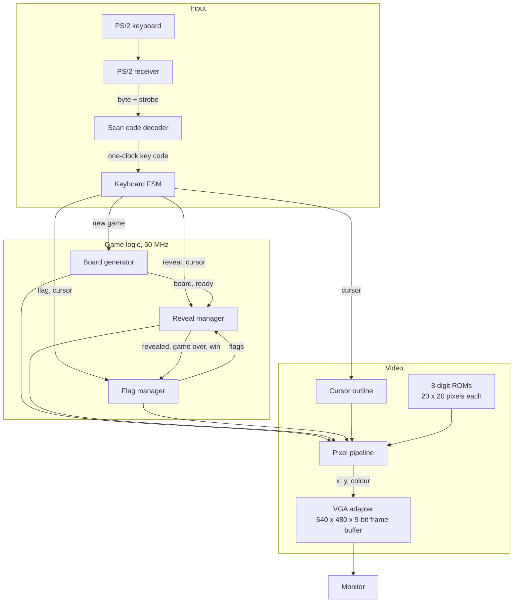
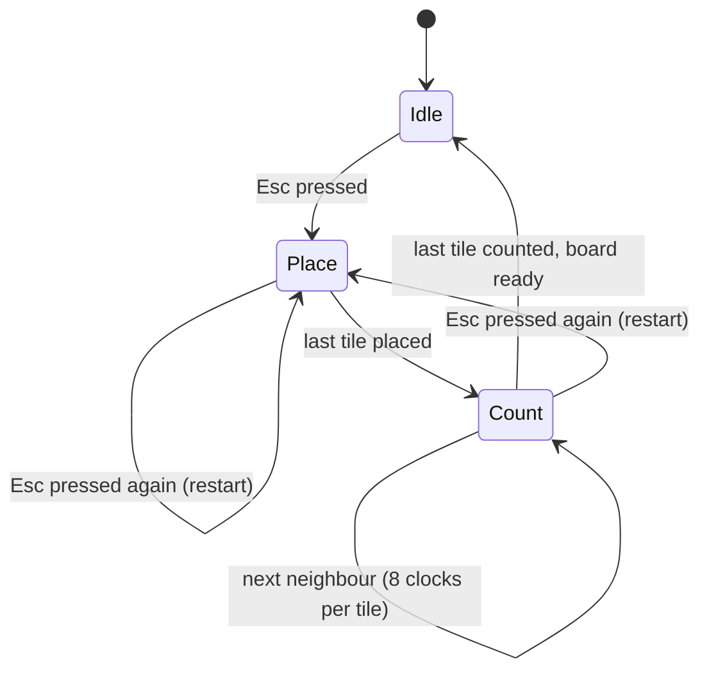
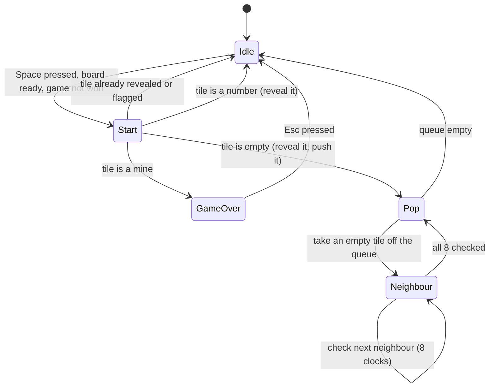
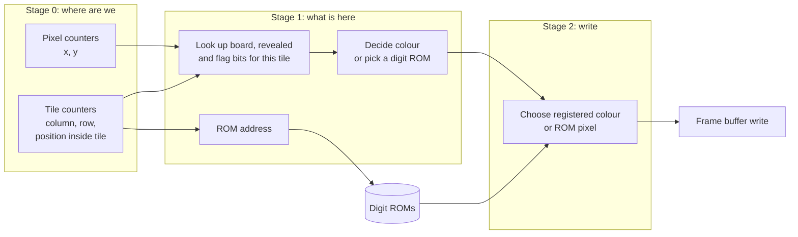
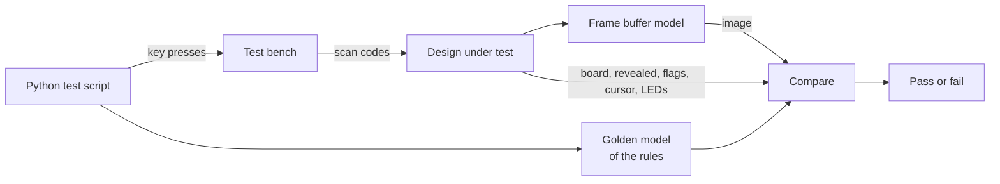

# Architecture

This document describes how the FPGA Minesweeper is put together: the data it keeps, the
state machines that change it, how a frame is drawn, and how the design is tested.

- [Overview](#overview)
- [Game state](#game-state)
- [Board generator](#board-generator)
- [Reveal manager and flood fill](#reveal-manager-and-flood-fill)
- [Flags](#flags)
- [Pixel pipeline](#pixel-pipeline)
- [Keyboard](#keyboard)
- [Clocks and reset](#clocks-and-reset)
- [Verification](#verification)
- [Things that went wrong along the way](#things-that-went-wrong-along-the-way)

## Overview

Each block is its own module. The game logic never talks to the screen directly: it only
maintains the three bit vectors described next, and the pixel pipeline reads them.

## Game state

The whole game is three vectors, indexed by `{y, x}` so that a tile's index is its row and
column side by side (no multiplication needed).

| Vector | Size | Meaning |
|---|---|---|
| Board | 256 x 4 bits | `0` to `8`: number of neighbouring mines. `15`: a mine. |
| Revealed | 256 x 1 bit | The tile has been opened. |
| Flags | 256 x 1 bit | The player has flagged the tile. |

Plus a 4-bit cursor column and row, a game-over bit and a win bit.

## Board generator

Pressing `Esc` builds a new board in two passes.

**Place.** One tile per clock. A 16-bit linear feedback shift register (polynomial
x16 + x14 + x13 + x11 + 1) supplies five fresh
bits per tile, and the tile becomes a mine when those bits are below a threshold. The
threshold is a parameter; 5 out of 32 gives about 40 mines, the density of the classic
16 x 16 intermediate board.

**Seed.** An FPGA has no source of randomness of its own. A 16-bit counter runs freely at
50 MHz and its value at the instant `Esc` goes down becomes the seed. The counter wraps
every 1.3 ms, far faster than anyone can time a key press, so each game is different. A
seed of zero is replaced, because an all-zero shift register would stay at zero and
produce a board with no mines.

**Count.** For every tile that is not a mine, the eight surrounding positions are checked
one per clock against the mine map and the total is stored. Positions are computed with
one extra bit so that -1 and 16 fall outside the board instead of wrapping to the other side.

The whole build takes 256 + 256 x 8 = 2,304 clocks, about 46 microseconds. A `ready`
signal stays low until it finishes, and nothing can be revealed or flagged while it is low.

## Reveal manager and flood fill

Opening an empty tile (a `0`) must open every tile connected to it through other empty
tiles, plus the numbered tiles around the edge. This is a breadth-first search:

1. Reveal the chosen tile. If it is empty, push it onto the queue.
2. Pop a tile. For each of its eight neighbours, one per clock: if it is on the board, not
   yet revealed and not flagged, reveal it, and if it is also empty, push it.
3. Repeat until the queue is empty.

A tile is pushed only at the moment it is first revealed, so it can enter the queue at
most once and 256 entries is always enough. Each popped tile costs nine clocks, which
bounds the whole fill at about 2,300 clocks (46 microseconds).

Because only empty tiles are ever popped, and an empty tile by definition has no mines
around it, the search can never open a mine.

**Game over.** Revealing a mine sets a sticky game-over bit and reveals every mine on the
board. The state machine then stays put until a new game is started.

**Win.** The game is won when every tile is either revealed or a mine. This is a single
256-bit check that runs continuously. Once it is true, further reveals are ignored.

## Flags

`Backspace` toggles the flag bit of the tile under the cursor. The rules that keep the
flags consistent with the rest of the game:

- A revealed tile cannot be flagged.
- A flagged tile cannot be revealed, and the flood fill goes around it.
- Flags are frozen once the game is won or lost.
- A new game clears them.

## Pixel pipeline

The picture is redrawn continuously, one pixel per clock, into the VGA adapter's frame
buffer. A full pass over 640 x 480 pixels takes 307,200 clocks, or 6.1 ms, so changes to
the game state reach the screen well within one monitor refresh.

**No dividers.** The board sits in the centre of the screen as a 320 x 320 square of
20 x 20 tiles. Working out "which tile, and where inside it" from a pixel coordinate is a
divide and a modulo by 20. Because pixels are visited strictly in order, two small
counters per axis give the same answers: a position inside the tile that counts 0 to 19,
and a tile number that steps each time it wraps.

**Layers.** For each pixel, from front to back:

| Layer | Appearance |
|---|---|
| Cursor | Red outline, 3 pixels thick, around the selected tile |
| Grid | White lines, 2 pixels on each edge of every tile |
| Flag | Red 7 x 7 dot in the middle of the tile |
| Mine | Green 7 x 7 dot (revealed tiles only) |
| Number | The digit image for 1 to 8, each in its own colour |
| Empty | Grey |
| Unrevealed | Black |

**Lining up the ROMs.** The digit images live in block memory, which registers its address:
the pixel for an address arrives one clock after the address is presented. Everything else
about the pixel is therefore registered once as well, including its coordinate, so that
the ROM output and the rest of the decision meet in the same clock and are written to the
right place.

**Memory.** The frame buffer is 640 x 480 x 9 = 2,764,800 bits and the eight digit ROMs
are 400 x 9 bits each, 28,800 bits in total.

## Keyboard

A PS/2 keyboard reports a key going down with its scan code and a key coming up with `F0`
followed by the same code.

| Key | Scan code | Used as |
|---|---|---|
| `W` | `1D` | Cursor up |
| `A` | `1C` | Cursor left |
| `S` | `1B` | Cursor down |
| `D` | `23` | Cursor right |
| `Space` | `29` | Reveal |
| `Backspace` | `66` | Flag |
| `Esc` | `76` | New game |

The decoder remembers whether the previous byte was `F0`. Movement keys produce an event
only on the way down. Reveal, flag and new game produce one event down and one up, which
the keyboard state machine turns into a level; the game modules act on its rising edge.
Holding a key therefore does nothing extra for those three, even though the keyboard
keeps repeating the code, while holding a movement key walks the cursor at the keyboard's
repeat rate. The cursor wraps around the edges of the board.

Any byte that is not `F0` clears the release marker, whether or not the key is one the
game uses, so pressing some other key can never cause the next real key press to be missed.

## Clocks and reset

All game logic and the pixel pipeline run on the board's 50 MHz clock. The only other
clock is inside the VGA adapter, which uses a PLL to make the 25 MHz pixel clock for the
monitor and reads the frame buffer from that side. The frame buffer is the only place the
two meet.

`KEY0` is an asynchronous active-low reset for the game state, the cursor and the pixel
pipeline.

## Verification

The design is simulated with Icarus Verilog. Two vendor blocks are swapped for simulation
models: the PS/2 receiver becomes a block that delivers whatever scan codes the test asks
for, and the VGA adapter becomes a plain frame buffer that can be written out as an image.
The block memory holding the digit images is modelled with the same one-clock delay as the
real part. Everything else is the real design.

A Python script generates the key presses, runs the simulation, and compares the result
with a separate implementation of the rules.

| Area | What is checked |
|---|---|
| Board generation | Neighbour counts are correct on 12 boards. A mine is no more likely directly after another mine than anywhere else. |
| Play | 560 random moves, reveals and flags over 4 boards, with the full game state compared after every step. |
| Winning | Opening every safe tile reveals exactly the safe tiles, lights the win LED, and the game cannot then be lost. |
| Losing | A mine ends the game, shows every mine, lights the game-over LED and freezes the board. `Esc` starts a different board. |
| Flags | Toggle, cannot reveal a flagged tile, cannot flag a revealed tile, cleared by a new game. |
| Keyboard | A key pressed after releasing an unused key still registers. Holding `Space` reveals once. Holding a movement key keeps moving. |
| Reset | `KEY0` clears everything. `Esc` during board generation still gives a valid board. Nothing can be revealed before the first board exists. |
| Picture | A rendered frame matches the expected image pixel for pixel. Every number has a visible digit image. |

All 22 checks pass. The images in this repository come from the same frame buffer model.

## Things that went wrong along the way

**A flood fill that stopped early.** The first version checked all eight neighbours in a
single clock and pushed every empty one onto the queue in the same clock. In hardware
those eight pushes all happen at once and all see the same queue position, so all but one
were lost and the search only ever followed one branch. Revealing an empty tile opened a
narrow path instead of the whole region. Checking one neighbour per clock fixed it, and
it also replaced eight parallel 256-way lookups with one. The lesson: a `for` loop in
hardware is not a sequence of steps, it is eight copies of the logic side by side.

**Mines in rows.** The shift register originally moved one bit per tile while two of its
bits decided each tile. Neighbouring tiles shared a bit, so a mine was followed by another
mine half the time and the board filled with horizontal runs. Giving each tile its own
bits made the layout look random.

**Digits one pixel off.** The digit ROMs answer one clock late. Without the extra pipeline
stage each digit was drawn one pixel to the right of where it belonged. Comparing a
simulated frame with the expected image pixel by pixel is what caught it.

**A swallowed key press.** Releasing a key the game does not use left the decoder waiting
for the second half of a release, so it mistook the next real key press for one.
